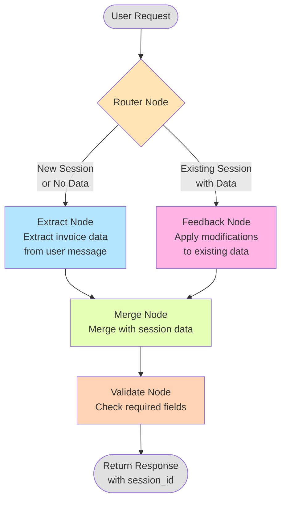
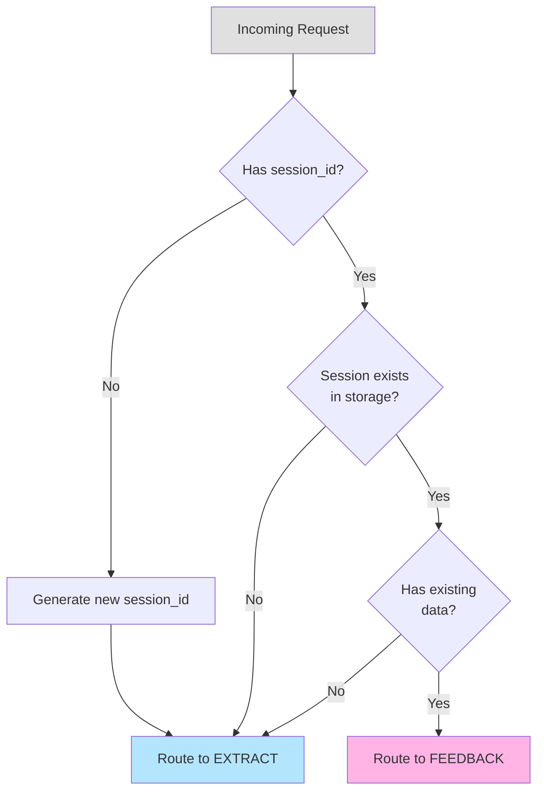
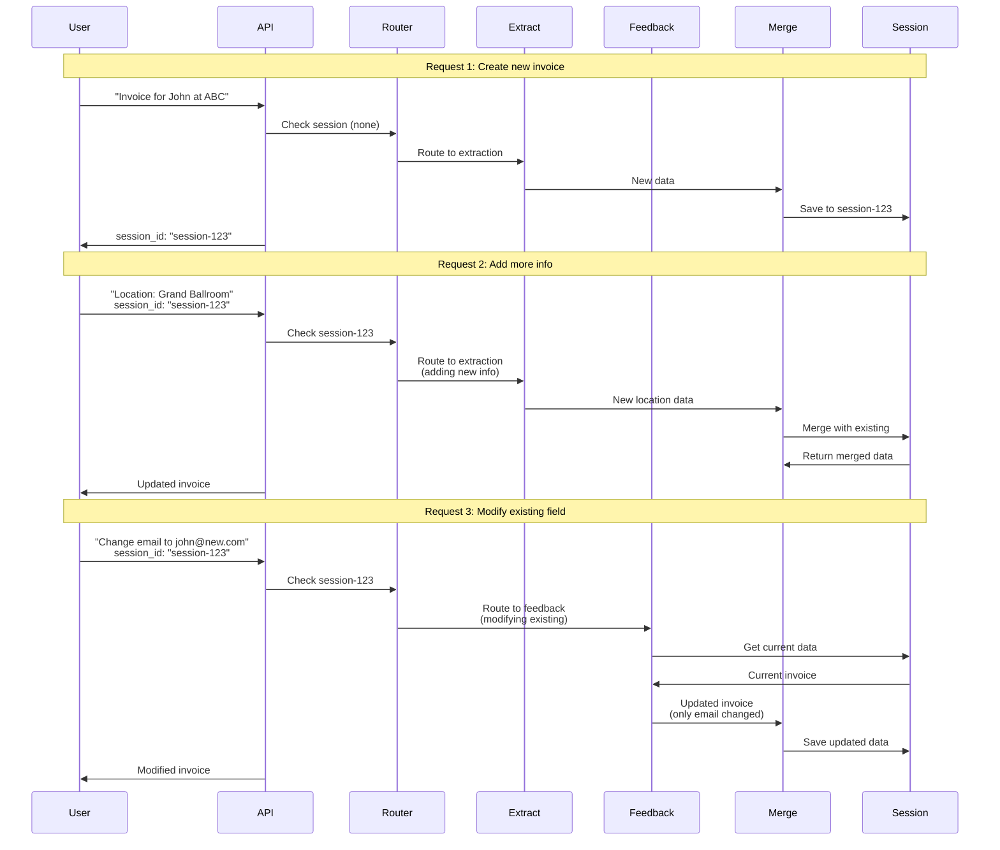
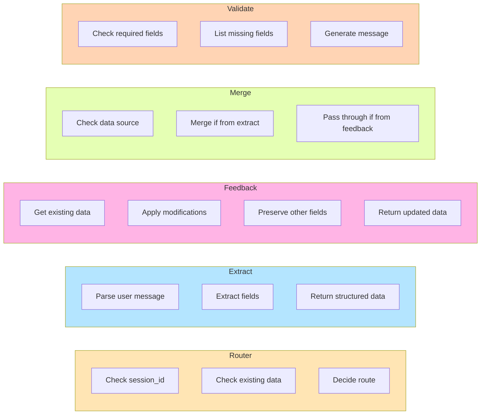
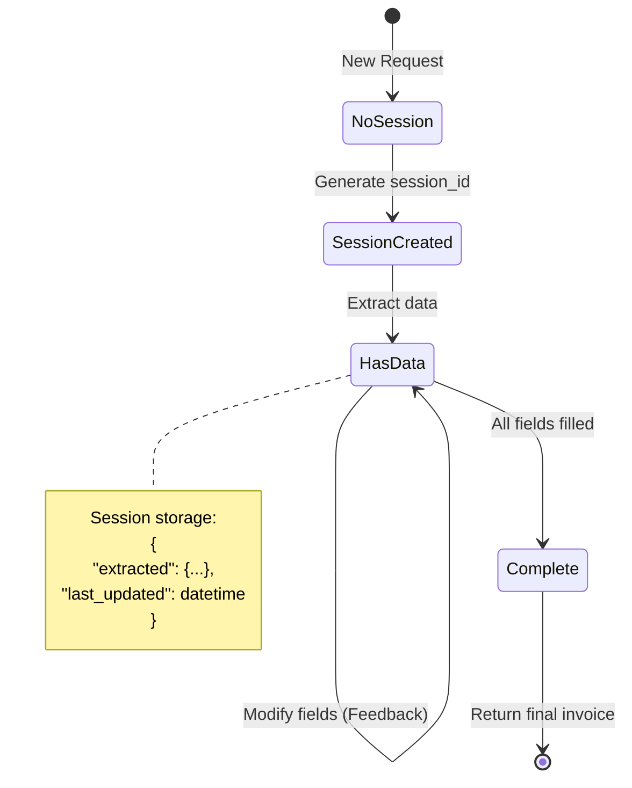

# Invoice AI Workflow Diagram

## Complete Workflow Graph

## Routing Decision Logic

## Data Flow Example

### Scenario: Creating and Modifying an Invoice

## Node Responsibilities

## State Management

